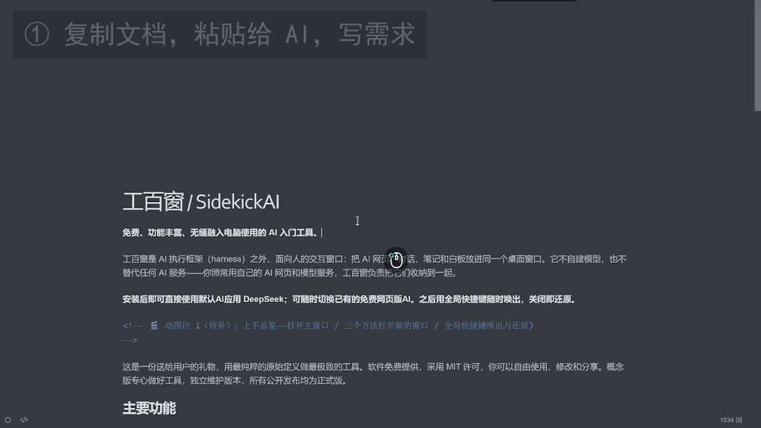
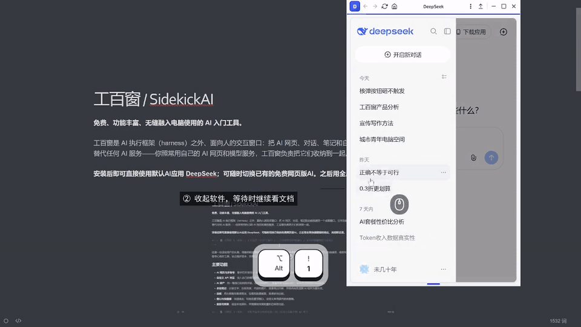

# 工百窗 / SidekickAI

**免费、功能丰富、无缝融入电脑使用的 AI 入门工具。**

工百窗是 AI 执行框架（harness）之外、面向人的交互窗口：把 AI 网页、对话、笔记和白板放进同一个桌面窗口。功能梗概：**一站式AI网站聚合、一站式需求收集与交付、网页对话资源本地化、多账号安全登录、内存占用优化**。

默认AI应用 DeepSeek，原生软件体验。

  

这是一份送给用户的礼物，用最纯粹的原始定义做最极致的工具。软件免费提供，采用 MIT 许可，你可以自由使用、修改和分享。概念版专心做好工具，独立维护版本，所有公开发布均为正式版。

## 主要功能

- **AI 网页与多账号**：集中打开常用 AI 网页，为不同账号保留独立的登录环境。
- **自定义 API 对话**：接入自己的模型服务，管理对话并保存聊天记录。
- **AI 资产**：统一整理已收纳的对话、提示词和资料，查看思考与历史修订，保存常用模板并快速调用。
- **本地笔记**：记录文字、任务列表、代码和图片，搜索笔记内容，并将内容发送到 AI 或存为提示词。
- **白板**：用无限画布整理想法、绘图和放置截图，管理多块白板。
- **窗口与快捷键**：快速唤出、切换和置顶窗口，自定义常用操作的快捷键。
- **备份与恢复**：导出本地资料，在需要时恢复配置和已保存内容。

  

## 特色功能

- **以简驭繁**：所有功能尽可能由快捷键驱动，主页面保持极简，更有Oxy Design System 以开发者审美帮你简化大部分功能。
- **随时唤出，用完即还原**：全局快捷键随时唤出使用，关闭后自动还原原来的窗口，全屏游戏中也可使用。
- **隔离与收纳**：每个网页保留独立的登录信息和打开记录，多个 AI 网页收纳在同一个应用内使用，占用比分别打开多个浏览器更小。
- **广告拦截**：内置网页广告拦截，AI 网页体验接近原生应用。
- **快捷键覆盖完整**：几乎所有页面都提供统一、符合直觉的快捷键。
- **备份还原**：备份导出涵盖登录信息和历史记录，支持可选密码加密。
- **本地安全**：收集的对话、提示词和资料全部保存在本机，不上传云端，收纳覆盖相对完整。
- **内存优化目标**：常态300MB以下，最小化70MB以下，最大占用不超过2GB。

## 数据与使用

对话资产、笔记、白板、提示词和设置保存在本机，已保存的本地内容可离线使用。AI 网页和远程模型服务需要网络，以及相应的账号或接口配置；第三方服务的使用条件和费用由对应服务提供方决定。

启用 AI 资产后，支持的 AI 页面与 API 对话会持续收纳内容；网页收纳范围取决于页面实际加载的内容。资料只自动保存用户上传、粘贴或拖入的附件，已有 AI 返回资料保留；“仅导出对话 JSON” 不会包含原件，迁移全部资料请使用完整备份。

## 三年维护承诺

**承诺持续维护概念版三年：至 2029 年 9 月 3 日。**

维护重点是修复影响使用的问题、保持工具兼容性，并持续改进已有功能的使用体验。

## 下载与安装

可下载版本均为正式版，支持 Windows x64 和 ARM64。

- **安装版**：安装后，从开始菜单或桌面快捷方式打开工百窗。
- **绿色版**：完整解压到安全目录后，直接运行对应架构目录中的 `SidekickAI.exe`。

下载后可按同一发布页的 SHA-256 校验值核对文件。安装版是官方独立构建的可选二进制产物；绿色版也可从本仓源码构建。

## 开发

开发建议使用项目根目录的 `launch.bat`，按菜单提示操作，建议预留空间:35G。

本仓维护软件源码、绿色版与标准应用载荷 ZIP，也提供调用二进制待组装包的完整包构建入口。安装、卸载和独立恢复附件的实现由私有分发工作区维护；任何人均可使用这些组件、自行开发安装卸载器，或只使用绿色版。自行构建使用独立身份，不代表官方发行；二进制组件与组装格式说明见私有分发工作区文档。

## 反馈与参与

使用问题和功能建议可通过仓库的 [Issues](https://github.com/LinCi853/SidekickAI/issues) 反馈。历史变化见 [更新日志](CHANGELOG.md)，代码贡献请参阅 [贡献指南](CONTRIBUTING.md)；安全漏洞请按 [安全策略](SECURITY.md) 私密报告。

## 开源依赖

应用使用 Electron、React、Tiptap 和 Excalidraw 等开源组件；第三方组件及字体遵循各自许可证，相关许可声明随软件分发。

## 许可证与商标

本项目采用 [MIT License](LICENSE)，© 2026 LinCi853。

工百窗是用户侧工具，不隶属于所接入的 AI 服务。第三方平台名称与商标归各自权利人所有，相关服务的使用遵循其各自条款。
