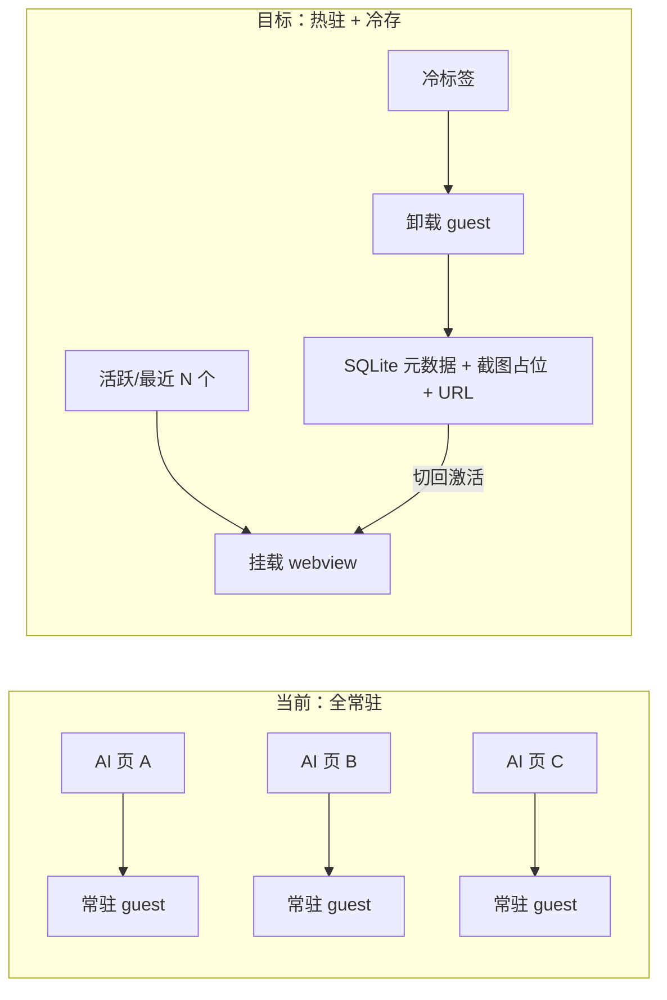

# 内存优化交接计划（多开 AI 应用 / 内存转存储）

> 交接基线：`main @ b741d4f`（`feat(ui): drawer redesign with menu settings, shortcut cleanup, safer block presets`）
> 工作区干净。本文档汇总现状诊断、目标方案、改动范围、验收标准，以及可直接粘贴给下一会话的提示词。

---

## 1. 背景与问题

工百窗 / SidekickAI 用 Electron `<webview>` 把多个 AI 网页收进同一应用。用户反馈：**同时打开多个 AI 应用时内存占用过高**，希望「内存转存储」——不活跃页面卸出内存，需要时再恢复。

### 现状结论（已核实）

内存大头在 **webview 生命周期策略**，不在存储层。业务数据已经基本落盘。

| 设计点 | 位置 | 影响 |
|---|---|---|
| webview 始终挂载 | `src/pages/MainView/WebviewTab.tsx:19`（注释写明）、`:170` 仅 `visibility: hidden` | 每个开过的标签 = 常驻 guest 进程 + 完整 JS 堆/DOM |
| DeferredTab 从不卸载 | `src/components/DeferredTab.tsx:9`：`active \|\| activated` | 只延迟首屏，激活后永久驻留 |
| `backgroundThrottling: false` | `electron/window-factory/web-preferences.ts:21` | 后台页面满速跑，CPU 高；对内存收益有限，别指望它省内存 |
| 每 Profile 独立 partition | `persist:${profileId}`（多账号隔离） | Cookie/缓存/进程按账号线性增长 |
| 无 freeze/discard/驱逐 | 全库无相关实现 | 打开只增不减，只能手动关标签 |

`src/lib/webview-lifecycle.ts` 的 snapshot/lease **与内存无关**，只是异步回调防陈旧。

### 存储侧现状（可复用，勿重做）

- 对话抓取 → SQLite（`conversation-store` / `ai-assets-store`）
- 登录态 / Cookie / IndexedDB → Chromium `Partitions/`（`session-dirs.ts`）
- 标签 URL/标题/顺序 → `window-store` 已持久化
- 笔记 / 白板 / 设置 → 各自 `.db`
- 磁盘缓存可清（`cache-maintenance.ts`）
- 截图 API 已有：`webview.capturePage()`（`src/lib/webview.ts:24`，先例：`useTabContextMenu.ts:150`）

**唯一不可序列化的是 SPA 运行态**（未提交草稿、滚动位置、前端路由深处）。恢复成本 = 同 partition 重载：登录不丢，页面内未保存草稿可能丢。

### 关键约束

Electron 层 **没有** Chrome 的 `WebContents.discard()`，做不到「整页换出再原样换回」。可行路径是 Chrome 标签丢弃同款：**快照占位 → 卸载 guest → 激活时按 URL 重载**。

---

## 2. 目标方案



默认策略建议：**同时最多挂载 active + 最近 2 个**，其余超时（约 5 分钟）真正 unmount。

---

## 3. 分阶段实施

### P1 快改（冷卸载 + 节流）· 约 1–2 天 · 5–8 文件 · 150–250 行

| 改动 | 文件 | 量级 |
|---|---|---|
| guest 节流 | `electron/window-factory/web-preferences.ts`；`WebviewTab.tsx` / `BrowserWebviewTab.tsx` 的 `webpreferences` 属性 | 数行～十几行 |
| DeferredTab → 可卸载 ManagedTab | `src/components/DeferredTab.tsx`（或新建 `ManagedTab.tsx`） | ~60–100 行 |
| 接入挂载点 | `src/pages/MainView/index.tsx:472`、`src/pages/BrowserView/index.tsx:342` | 各 ~10 行 |
| `lastActiveAt` | `src/store/useTabStore.ts`、必要时 `useBrowserTabStore` | ~30 行 |
| 测试 | `DeferredTab.test.tsx` 扩展 | ~80 行 |

注意：
- `electron/voice/preview-window.ts:121` 的 `backgroundThrottling: false` **不要改**（语音预览故意不节流）。
- 卸载会丢 SPA 状态，属产品取舍，见「待拍板」。

### P2 休眠（核心「内存转存储」）· 约 3–5 天 · 15–25 文件 · 900–1500 行

| 改动 | 文件 | 量级 |
|---|---|---|
| 休眠元数据 | **新建** `electron/store/tab-hibernate-store.ts`（url/title/scrollY/截图路径/hibernatedAt） | ~150–250 行 + 测试 |
| 休眠前快照 | 复用 `capturePage()`，落盘到 `.app-data` 或资产目录 | ~80–120 行 |
| 卸载/恢复编排 | **新建** `src/pages/MainView/hooks/useTabHibernation.ts`；改 `useWebviewRemount.ts`（恢复走现有 `remountKey`） | ~150–200 行 |
| 占位 UI | **新建** `TabHibernatePlaceholder.tsx`（截图 +「点击恢复」） | ~100–150 行 |
| 设置项 | `electron/shared/api/settings.api.ts`、`app-settings-defaults.ts`、`app-settings-repository.ts`、SettingsPanel section | ~150–200 行 |
| IPC（如需） | `ipc-channels.ts` + handler + preload | ~80–120 行 |
| 截图保留策略 | 并入 `attachment-retention` / `cache-maintenance` 同类 | ~50 行 |
| 测试 | store / hook / 组件 | ~250–400 行 |

风险点：
1. **恢复竞态**：`webview-lifecycle` generation/lease 必须与 remount 同步，否则注入/抓取绑到旧 guest。
2. **beforeunload**：销毁 guest 可能弹离开确认——复用 `builtin-block-beforeunload` 与 `will-prevent-unload` 处理，不要另起一套。
3. **截图隐私**：占位图是页面内容，要进保留天数/一键清理（`StorageSection` / `CookieSection` 旁）。
4. **多窗口**：主窗口、独立浏览器窗（`persist:${id}-browser`）、detach 窗口共用策略，否则只优化主窗。

### P3 预算驱逐 · 约 2–3 天 · 8–12 文件 · 400–700 行（依赖 P2）

| 改动 | 文件 | 量级 |
|---|---|---|
| 内存监控 | 复用 `electron/diagnostics/runtime-processes.ts` 的 `getAppMetrics`，主进程加 pressure monitor | ~100–150 行 |
| 驱逐策略 | 调 P2 hibernate：总/单 guest 超阈值 → 休眠最冷标签 | ~100 行 |
| 后台优先级 | 非活跃 guest `process.processPriority = 'background'`（`webview-registry` 已有 contents 映射） | ~40 行 |
| 设置 + 观测 | `AppSettings` 阈值；`RuntimeProcessesSection` 显示已休眠数 | ~100 行 |
| 测试 | 策略单测 + 边界 | ~150–250 行 |

### 总量

| 档位 | 文件数 | 代码量（含测试） | 预估 |
|---|---|---|---|
| P1 | 5–8 | 150–250 行 | 1–2 天 |
| P2 | 15–25 | 900–1500 行 | 3–5 天 |
| P3 | 8–12 | 400–700 行 | 2–3 天 |
| 全做 | 约 25–40 触点 | 约 1.5k–2.5k 行 | 约 1–1.5 周（含验证） |

几乎不用动：SQLite 业务库、backup、partition 隔离、对话抓取。

---

## 4. 验收标准

1. `npm run verify` 全绿（product/shared/versions/architecture + typecheck + tooling + tests）。
2. 内存对比（写进 PR/交接记录）：同时打开 6 个真实 AI 页，全部切换一遍后等待冷却，进程总工作集相对基线显著下降（建议目标：非活跃 guest 被卸载后，主进程 + 剩余 guest 之和 ≤ 基线的约 40–60%，以实测为准）。
3. 功能回归：
   - 冷标签切回能恢复登录态，URL 正确；
   - 对话抓取在休眠前后不丢；
   - 崩溃 remount（`useWebviewRemount`）仍可用；
   - 独立窗口 / detach 窗口不异常泄漏或白屏。
4. 截图占位可清理，不长期堆积磁盘。

---

## 5. 待产品拍板（动手前确认）

1. **冷卸载丢 SPA 状态是否可接受？**
   - 可接受 → 按默认策略做（最近 2 个热驻 + 超时卸载）。
   - 不可接受 → 策略改保守（只卸载超过 X 小时的标签 + 显式提示），P2 范围会缩小。
2. **休眠开关默认开还是关？**
   - 默认开才兑现「多开省内存」卖点，但会改变「切回即用」体验。
   - 建议：设置项 `tabHibernate: 'off' | 'balanced' | 'aggressive'`，默认 `balanced`。

---

## 6. 交接提示词（可直接粘贴）

### 提示词 A — 完整实施（推荐）

```text
你在 E:\SidekickAI 仓库工作（工百窗 / SidekickAI，Electron + React + better-sqlite3）。

任务：实现「多开 AI 应用内存优化 + 标签休眠（内存转存储）」。完整计划见
docs/handoffs/memory-optimization-handoff.md，请先通读该文档与 README.md、AGENTS.md。

背景结论（已核实，不要重新调研到方向上）：
- 内存大头是 webview 常驻：DeferredTab 激活后从不卸载，WebviewTab 仅 visibility:hidden。
- 业务数据已落盘（SQLite + Partitions），缺的是 guest 卸载/恢复。
- Electron 无 WebContents.discard()，方案是：快照占位（capturePage）→ 卸载 webview →
  激活时按 URL + remountKey 重载。

请按 P1 → P2 → P3 递进交付，每阶段做完跑 npm run verify 并汇报内存对比：
1. P1：ManagedTab（LRU，热驻 active+最近 2）+ lastActiveAt + backgroundThrottling 调整
   （不要改 electron/voice/preview-window.ts 的 false）。
2. P2：tab-hibernate-store + 截图占位 + useTabHibernation + 设置项。
3. P3：内存预算驱逐 + processPriority + RuntimeProcessesSection 观测。

硬约束：
- 不破坏多账号 partition 隔离（persist:${profileId}）。
- 卸载前复用现有 beforeunload 清理与 will-prevent-unload 处理。
- webview-lifecycle generation/lease 必须与 remount 同步。
- 截图占位要有保留/清理策略。
- 代码英文，注释/界面中文，UTF-8；禁止在注释/提交信息里出现开发进度术语和 AI 工具名。
- 任务拆成可独立验证的子任务；实现与审查分离。
- 每次构建/会话结束跑 npm run clean:budget（build/ 不得超 15 GiB）。
- 不要 push，不要改 git config。

开始前若产品默认值（热驻数量、超时、休眠模式默认档）未在计划中拍板，按文档建议值实现并在汇报中注明。
```

### 提示词 B — 只做 P1（最小可验证）

```text
你在 E:\SidekickAI 仓库工作。先读 docs/handoffs/memory-optimization-handoff.md。

只做 P1 快改，目标是可测的内存下降：
1. 将 DeferredTab 升级为可卸载的 ManagedTab：非活跃且超出「active + 最近 2 个」的
   webview 真正 unmount（销毁 guest），保留 useTabStore 里的 tab 元数据。
2. useTabStore / useBrowserTabStore 记录 lastActiveAt，切换标签时更新。
3. webview 打开 backgroundThrottling（注意 voice/preview-window.ts 的 false 保持不动）。
4. MainView/index.tsx 与 BrowserView/index.tsx 两处挂载点接入。
5. 补测试；跑 npm run verify；用 5+ 个 AI 页对比卸载前后工作集。

不要开始休眠表/设置面板/预算驱逐（P2/P3）。完成后写一份简短结果（改了什么、
内存对比数字、遗留风险）。
```

### 提示词 C — 方案评审 / 扩展设计（不动代码）

```text
阅读 docs/handoffs/memory-optimization-handoff.md 与 E:\SidekickAI 相关源码。
请从产品与工程两面评审该内存优化方案：
- 冷卸载丢 SPA 状态的可接受边界与替代（如表单草稿自动存、scroll 恢复）；
- P2 截图占位的隐私/磁盘成本；
- 多窗口（主窗 / persist:${id}-browser / detach）策略如何统一；
- 是否有比「卸载+重载」更优的 Electron 可行路径（须能落地，不要提做不到的
  V8 堆序列化）。
输出：风险清单 + 对计划的修订建议 + 仍需用户拍板的问题列表。不要改代码。
```

---

## 7. 快速索引

| 需要 | 去处 |
|---|---|
| 交接总览 | 本文档 |
| 产品说明 | `README.md` |
| 构建/磁盘约束 | `AGENTS.md`（`npm run clean:budget`，build/ ≤ 15 GiB） |
| 验证入口 | `npm run verify` |
| 标签挂载 | `src/pages/MainView/index.tsx`、`src/pages/BrowserView/index.tsx` |
| Webview 组件 | `src/pages/MainView/WebviewTab.tsx`、`src/pages/BrowserView/BrowserWebviewTab.tsx` |
| 延迟挂载 | `src/components/DeferredTab.tsx` |
| 恢复/remount | `src/pages/MainView/hooks/useWebviewRemount.ts` |
| 设置定义 | `electron/shared/api/settings.api.ts` + `electron/store/app-settings-defaults.ts` |
| 进程内存采集 | `electron/diagnostics/runtime-processes.ts` |
| 截图先例 | `src/pages/MainView/useTabContextMenu.ts`（`screenshotToWhiteboard`） |
