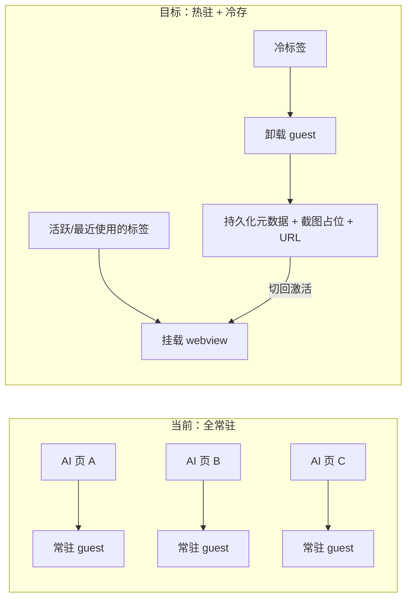

# 内存优化交接计划（多开 AI 应用 / 内存转存储）

> 2026-10-17 源码清理与 x64 正式打包以[本次交付记录](memory-cleanup-release-2026-10-17.md)为准。停用的标签冷卸载、截图占位、预算驱逐和最小宿主原型已从源码移除；旧文档中的文件与命令仅供历史追溯，不能作为当前可运行入口。

> 2026-10-17 重启反馈后的最新修改与证据见[启动回收保护范围修正](memory-startup-reclaim-2026-10-17.md)：慢加载或媒体不再阻塞无关后台窗口和同窗独立 guest 的回收；共享服务与当前工作继续保护。300 MiB 标准态尚未达成。

> 2026-10-17：原执行聊天已完成交接并停止写入。后续先按[启动成本拆解](memory-startup-cost-2026-10-17.md)定位运行时、产品服务和界面/GPU成本；交接现场见[接管记录](memory-takeover-2026-10-17.md)。以下历史阶段计划不能覆盖后续已确认的页面持续挂载要求。

> 当前有效设计：[窗口三状态设计与验收](window-memory-states.md)。旧 1240 MB 目标和放宽退役建议已被替代；可见未聚焦退役与时长以代码为准（2026-10-16 用户确认）。

> 以下为历史设计与实测存档。2026-10-17用户已要求删除标签冷卸载、截图占位与点击恢复，已加载网页保持挂载；只在开发者选项保留一个低内存模式开关，允许内置自身进程工作集清空。当前策略见[持续回收机制](memory-resident-research.md)，当前证据见[实测报告](memory-optimization-memory-report.md)。不要恢复下文旧的冷卸载功能，也不要再就已经授权的工作集清空请求确认。

> 交接基线：`main @ b741d4f`（`feat(ui): drawer redesign with menu settings, shortcut cleanup, safer block presets`）
> 工作区干净。本文档给出问题背景、需求、约束、方案与验收，供后续会话完整实施。

---

## 1. 背景与问题

工百窗 / SidekickAI 用 Electron `<webview>` 把多个 AI 网页收进同一应用。用户反馈：**同时打开多个 AI 应用时内存占用过高**，希望「内存转存储」——不活跃页面卸出内存，需要时再恢复。

现状结论（已核实）：内存大头在 **webview 生命周期策略**，不在存储层。业务数据已基本落盘。

| 设计点 | 位置 | 影响 |
|---|---|---|
| webview 始终挂载 | `src/pages/MainView/WebviewTab.tsx`（仅 `visibility: hidden`） | 每个开过的标签 = 常驻 guest 进程 + 完整 JS 堆/DOM |
| DeferredTab 从不卸载 | `src/components/ManagedTab.tsx`（`active \|\| activated`） | 只延迟首屏，激活后永久驻留 |
| `backgroundThrottling: false` | `electron/window-factory/web-preferences.ts` | 后台页面满速跑，CPU 高；对内存收益有限 |
| 每 Profile 独立 partition | `persist:${profileId}`（多账号隔离） | Cookie/缓存/进程按账号线性增长 |
| 无 freeze/discard/驱逐 | 全库无相关实现 | 打开只增不减，只能手动关标签 |

`src/lib/webview-lifecycle.ts` 的 snapshot/lease 与内存无关，只是异步回调防陈旧。

存储侧现状（可复用，勿重做）：对话抓取已进 SQLite（`conversation-store` / `ai-assets-store`）；登录态 / Cookie / IndexedDB 在 Chromium `Partitions/`（`session-dirs.ts`）；标签 URL/标题/顺序由 `window-store` 持久化；磁盘缓存可清（`cache-maintenance.ts`）；截图 API 已有 `webview.capturePage()`（`src/lib/webview.ts`，先例：`useTabContextMenu.ts` 的 `screenshotToWhiteboard`）。

**唯一不可序列化的是 SPA 运行态**（未提交草稿、滚动位置、前端路由深处）。恢复成本 = 同 partition 重载：登录不丢，页面内未保存草稿可能丢。

**关键约束**：Electron 层没有 Chrome 的 `WebContents.discard()`，做不到「整页换出再原样换回」。可行路径是 Chrome 标签丢弃同款：**快照占位 → 卸载 guest → 激活时按 URL 重载**。

---

## 2. 需求

### 核心需求

1. **内存可控**：多开场景下，不活跃标签不得长期占用常驻内存；打开的标签数不应与内存占用线性增长。
2. **内存转存储**：不活跃页面卸出内存，其必要信息（URL、标题、占位快照等）持久化到磁盘，需要时可恢复。
3. **可恢复**：冷标签切回时能恢复到原页面——登录态不丢，URL 正确，占位 UI 显示「此页已休眠、点击/切换即恢复」（该文案**应当出现**，与 `TabHibernationPlaceholder.tsx` 一致）。
4. **数据不丢**：休眠/卸载/恢复的全过程不得丢失业务数据——对话抓取、标签元数据、笔记白板等照常工作。
5. **安全降级**：销毁 guest 前处理好页面的离开确认（beforeunload），不得出现无法关闭的弹窗或页面被强杀导致的数据丢失。
6. **隐私与磁盘**：休眠快照属于页面内容，必须纳入保留与清理策略，不得无限堆积磁盘。
7. **策略可配置**：休眠行为提供设置项（开关/强度），默认值在实施时确定并写入汇报。
8. **多窗口一致**：主窗口、独立浏览器窗、detach 窗口共用同一套策略，不允许只优化主窗口。
9. **崩溃恢复不回退**：现有崩溃 remount（`useWebviewRemount`）机制继续可用，且与卸载/恢复编排保持同步。
10. **不得妨碍正常使用（最高产品约束之一）**：清理/卸载不得打断用户正在使用的页面或窗口。用户切走一会儿再回来，页面应仍在；设置窗、浏览器窗等不应被后台过早销毁。省内存策略必须让位于正常使用。

### 非目标

- 不追求 SPA 运行态（草稿、滚动位置、路由深处）的无损恢复——此类状态丢失属产品接受的取舍，如需缓解另行立项。
- 不重做存储层：SQLite 业务库、backup、partition 隔离、对话抓取均不动。
- 不做 V8 堆序列化等 Electron 落不了地的方案。

---

## 3. 硬约束

- 不破坏多账号 partition 隔离（`persist:${profileId}`）。
- 卸载前复用现有 `builtin-block-beforeunload` 与 `will-prevent-unload` 处理，不要另起一套。
- `webview-lifecycle` 的 generation/lease 必须与 remount 同步，否则注入/抓取会绑到旧 guest。
- `electron/voice/preview-window.ts` 的 `backgroundThrottling: false` 保持不动（语音预览故意不节流）。
- 代码英文，注释/界面中文，UTF-8；禁止在注释/提交信息里出现开发进度术语和 AI 工具名。
- 任务拆成可独立验证的子任务；实现与审查分离。
- 每次构建/会话结束跑 `npm run clean:budget`（`build/` 不得超 15 GiB）。
- 不要 push，不要改 git config。

---

## 4. 方案概要



核心机制：热驻标签正常挂载 webview；超出热驻范围且闲置超时的标签，在落盘元数据与占位快照后真正 unmount（销毁 guest）；切回时按 URL 重载（登录态由 partition 保留）。热驻数量、闲置超时、驱逐阈值等参数可配置，具体取值实施时确定。

---

## 5. 分阶段实施（完整交付）

按 P1 → P2 → P3 递进，三阶段全部完成方为交付；每阶段独立可验证。

### P1 冷卸载 + 节流

- `DeferredTab` 升级为可卸载的托管组件（`ManagedTab`）：非活跃且超出热驻范围的 webview 真正 unmount，标签元数据保留在 store。
- `useTabStore` / `useBrowserTabStore` 记录 `lastActiveAt`，切换标签时更新，作为冷热判定依据。
- webview 打开 `backgroundThrottling`（注意语音预览窗口的 `false` 不动）。
- 接入两处挂载点：`src/pages/MainView/index.tsx`、`src/pages/BrowserView/index.tsx`。
- 补测试。

### P2 休眠（核心「内存转存储」）

- 新建休眠元数据存储（`electron/store/tab-hibernate-store.ts`）：url / title / 截图路径 / 休眠时间等。
- 卸载前用 `capturePage()` 生成占位快照并落盘，纳入现有 `attachment-retention` / `cache-maintenance` 的保留与清理体系。
- 卸载/恢复编排（`useTabHibernation`）：与 `useWebviewRemount`、`webview-lifecycle` 的 generation/lease 对齐。
- 占位 UI（截图 + 「点击恢复」）。
- 设置项：接入 `settings.api.ts` / `app-settings-defaults.ts` / `app-settings-repository.ts` 与 SettingsPanel；如需 IPC 按现有通道模式扩展。
- 测试。

### P3 预算驱逐（依赖 P2）

- 主进程内存监控：复用 `electron/diagnostics/runtime-processes.ts` 的 `getAppMetrics`。
- 驱逐策略：内存压力超阈值时调用 P2 休眠，优先驱逐最冷标签；阈值进设置项。
- 非活跃 guest 设 `process.processPriority = 'background'`（`webview-registry` 已有 contents 映射）。
- 观测：`RuntimeProcessesSection` 展示休眠/驱逐状态。
- 测试。

---

## 6. 验收标准

1. `npm run verify` 全绿（product/shared/versions/architecture + typecheck + tooling + tests）。
2. 内存对比（写进 PR/交接记录）：同时打开多个真实 AI 页并全部切换一遍、等待冷却后，进程总工作集相对基线明显下降，且不随打开过的标签数线性增长。
3. 功能回归：
   - 冷标签切回能恢复登录态，URL 正确；
   - 对话抓取在休眠前后不丢；
   - 崩溃 remount（`useWebviewRemount`）仍可用；
   - 独立窗口 / detach 窗口不异常泄漏或白屏；
   - 有离开确认的页面卸载时行为符合既有 beforeunload 处理，不卡死、不误杀。
4. 休眠快照可清理，不长期堆积磁盘；清理入口对用户可见。
5. 设置项生效：调整休眠策略后行为随之变化。

---

## 7. 待产品拍板

以下默认值不写死在计划里，实施时确定并在汇报中注明；若产品有明确倾向请优先告知：

1. 冷卸载丢 SPA 状态的可接受边界——直接按默认策略做，还是只卸载长时间不活跃的标签并显式提示。
2. 休眠功能的默认开关与强度档位。

---

## 8. 交接提示词（可直接粘贴）

```text
你在 E:\SidekickAI 仓库工作（工百窗 / SidekickAI，Electron + React + better-sqlite3）。

任务：完整实现「多开 AI 应用内存优化 + 标签休眠（内存转存储）」。需求、约束与方案见
docs/handoffs/memory-optimization-handoff.md，请先通读该文档与 README.md、AGENTS.md。
需求是验收依据；文档未写死的参数（热驻数量、闲置超时、休眠默认档、驱逐阈值）
按需求合理取值，做成可配置，并在汇报中注明。

背景结论（已核实，不要重新调研到方向上）：
- 内存大头是 webview 常驻：DeferredTab 激活后从不卸载，WebviewTab 仅 visibility:hidden。
- 业务数据已落盘（SQLite + Partitions），缺的是 guest 卸载/恢复。
- Electron 无 WebContents.discard()，方案是：快照占位（capturePage）→ 卸载 webview →
  激活时按 URL + remountKey 重载。

请按 P1 → P2 → P3 完整交付，三阶段都做完才算完成，每阶段跑 npm run verify 并汇报内存对比：
1. P1：ManagedTab 冷卸载 + lastActiveAt + backgroundThrottling 调整
   （不要改 electron/voice/preview-window.ts 的 false）。
2. P2：tab-hibernate-store + 截图占位（含保留/清理）+ useTabHibernation + 设置项。
3. P3：内存预算驱逐 + processPriority + RuntimeProcessesSection 观测。

硬约束：
- 不破坏多账号 partition 隔离（persist:${profileId}）。
- 卸载前复用现有 beforeunload 清理与 will-prevent-unload 处理。
- webview-lifecycle generation/lease 必须与 remount 同步。
- 截图占位要有保留/清理策略。
- 代码英文，注释/界面中文，UTF-8；禁止在注释/提交信息里出现开发进度术语和 AI 工具名。
- 任务拆成可独立验证的子任务；实现与审查分离。
- 每次构建/会话结束跑 npm run clean:budget（build/ 不得超 15 GiB）。
- 不要 push，不要改 git config。
```

---

## 9. 快速索引

| 需要 | 去处 |
|---|---|
| 交接总览 | 本文档 |
| 产品说明 | `README.md` |
| 构建/磁盘约束 | `AGENTS.md`（`npm run clean:budget`，build/ ≤ 15 GiB） |
| 验证入口 | `npm run verify` |
| 标签挂载 | `src/pages/MainView/index.tsx`、`src/pages/BrowserView/index.tsx` |
| Webview 组件 | `src/pages/MainView/WebviewTab.tsx`、`src/pages/BrowserView/BrowserWebviewTab.tsx` |
| 托管挂载 | `src/components/ManagedTab.tsx` |
| 恢复/remount | `src/pages/MainView/hooks/useWebviewRemount.ts` |
| 设置定义 | `electron/shared/api/settings.api.ts` + `electron/store/app-settings-defaults.ts` |
| 进程内存采集 | `electron/diagnostics/runtime-processes.ts` |
| 截图先例 | `src/pages/MainView/useTabContextMenu.ts`（`screenshotToWhiteboard`） |


---

## 10. 交付记录

### 可配置默认值

| 参数 | 默认 | 说明 |
|---|---|---|
| tabColdUnloadEnabled | true | 冷卸载总开关 |
| tabHotResidentLimit | 3 | 热驻标签数（含当前激活） |
| tabIdleMinutes | 15 | 闲置多久进入冷候选 |
| tabHibernationEnabled | true | 休眠落盘占位 |
| tabScreenshotPlaceholder | true | 卸载前抓占位快照 |
| tabScreenshotRetentionDays | 7 | 快照保留天数 |
| tabScreenshotMaxCount | 40 | 快照最大张数 |
| tabMemoryBudgetMb | 0 | 内存预算上限（MB），0 表示不按内存驱逐 |

时间基准由 useTabHibernation 每 30 秒推进；标签切换立即重算冷集合。

### 内存对比（机制层）

| 场景 | 旧行为 | 现行为 |
|---|---|---|
| 打开 N 个 AI 标签并切换一遍 | N 个 guest 常驻，工作集随 N 线性涨 | 仅热驻（默认 3）保留 guest；其余卸载后只留元数据+快照 |
| 冷标签切回 | 无 | 同 partition 按 URL 重挂，登录态由 persist:<profileId> 保留 |
| 后台窗口/标签 | backgroundThrottling: false 全速跑 | 默认节流（语音预览窗仍为 false） |
| 超内存预算 | 无 | 主进程按工作集广播，驱逐最冷未休眠标签 |

完整数值对比、敏感度分析与真机复现步骤见 memory-optimization-memory-report.md。

### 验证

npm run verify：183 文件 / 1456 测试全绿（上一会话自报，本会话未复跑，需重新确认）
npm run typecheck：本会话通过
npm run clean:budget：build/ 6.06 GiB ≤ 15 GiB（本会话实测）

### 多窗口覆盖说明

| 窗口 | 策略接入 | 说明 |
|---|---|---|
| 主窗口 | ManagedTab + useTabHibernation | 热驻/冷卸/休眠完整 |
| 独立浏览器窗 | ManagedTab + useTabHibernation | 同上，并保护出声标签 |
| detach 窗 | 同一 partition / 元数据规则 | 单标签恒为激活，冷卸载空转（激活标签永不休眠） |

processPriority：Node 无 PRIORITY_BACKGROUND，以 os.setPriority(pid, PRIORITY_LOW) 落地（Windows 为 BELOW_NORMAL），注释中已说明。

---

## 11. 目标口径修正与真机实测（2026-10-16）

### 11.1 目标改为三档（优先级高于本文档第 6 节与 memory-report）

| 状态 | 目标 |
|---|---:|
| 常态（前台使用中） | ≤ 300 MB |
| 最小化 / 隐藏后 | ≤ 70 MB |
| 多开上限 | ≤ 1240 MB |

第 6 节的「不与标签数线性增长」仍是验收依据，但**绝对数值以本节三档为准**。
memory-report.md 的 238 MB 只是「热驻 3 页的 Tab 进程合计」，**不含壳、GPU、网络**，
不可直接与该三档对比，需重新出数。

### 11.2 实测数据（单标签场景，工作集合计）

环境：Windows 11 / Electron（`node_modules/electron/dist`）/ `node_modules/electron/dist/electron.exe .`
应用数据：`E:\SidekickAI\.app-data`（开发态 `.app-data`，非 `AppData\Roaming\SidekickAI`）

| 状态 | 合计 | main | gpu | ui×2 | net |
|---|---:|---:|---:|---:|---:|
| 前台，1 个 AI 页（DeepSeek） | **727 MB** | 150.6 | 214.5 | 305.6 | 56.8 |
| 最小化后 45 秒 | **714.8 MB** | 151.7 | 213.3 | 293.2 | 56.7 |

**结论：最小化后 45 秒内总工作集几乎无变化（−12 MB），后台释放完全未生效。**

### 11.3 根因证据（已确认的部分）

主进程日志（`local/app-run.log`，42 行）显示释放**只跑完主进程一半**：

```
[background-release] 已计划 12000ms 后评估后台释放
[background-release] 检测到应用无焦点，开始释放
[background-release] 纯后台释放: secondary=0 (guest 由渲染层卸载，主窗保留)
```

- `secondary=0` 属正常（仅开了主窗，无次窗口可收）。
- 渲染层侧**一条相关日志都没有**：
  - `src/pages/MainView/index.tsx:424` 分支内的 `[main-view] 后台已卸载 UI 树并释放 guest` 未出现；
  - `[managed-tab]` / `[tab-hibernation]` 也未出现；
  - `[target-registry] 已注册: webview-2 (webview)` 之后**无任何注销记录**。

即：主进程侧 `scheduleBackgroundRelease()` 触发了，但渲染层的 `hiddenRelease`
（`src/hooks/useTabHibernation.ts`，经 IPC `WINDOW_HIDDEN` / `window` blur 触发）
没有把 UI 树卸载掉。

**待验证的两个嫌疑点**（本次未及证实，交接后优先做）：

1. 主进程 `win.on('minimize')` 确实 `send(IPC_CHANNELS.WINDOW_HIDDEN)` 了，但渲染层
   `onWindowHidden` 的注册时机或 preload 通道可能有问题（需确认 `WINDOW_HIDDEN` 是否真的到达渲染层）。
2. 渲染层同时监听了 `window` 的 `blur`/`focus`（`useTabHibernation.ts`）。最小化时
   `blur` 会 arm 一个 12s 定时器，但主进程 `show`/`restore` 或 React 重挂可能把它清掉。
   需确认 `hiddenRelease` state 究竟有没有变成 `true`。

### 11.4 进程模型事实（影响 P3 有效性）

实测本机 Electron 启动参数为 `--no-sandbox --no-zygote`，且**所有 renderer 共享同一组命令行**：

```
--type=renderer --user-data-dir="E:\SidekickAI\.app-data" --standard-schemes=...
  --app-path="E:\SidekickAI" --no-sandbox --no-zygote ...
```

推论（**需真机复核后再据此改代码**）：

- 单标签时只有 **2 个 renderer**，且都带 `--standard-schemes`（应用壳特征），
  **没有独立的 guest 网页进程**——guest 与界面共用 renderer 进程。
- 因此 `electron/diagnostics/runtime-processes.ts` 的 `processRole()` 按
  `targets.every(kind === 'window')` 区分 `interface` / `webpage`，在真机上可能
  判不出 `webpage`，导致：
  - `memory-budget-monitor.ts` 只累加 `role === 'webpage'` 的进程 → 合计恒为 0 / 极小；
  - 叠加 `tabMemoryBudgetMb` 默认 `0`（不启用），**预算驱逐路径实际上从未触发过**。
- `tab-process-priority.ts` 依赖 `getRecordByWebContentsId()` 找到 guest 的 pid，
  在 guest 与壳同进程的情况下，降优先级会连带压低界面渲染优先级。

> 以上是「单标签 + 当前启动参数」下的观测。多标签（≥4 个 AI 页）时是否
> 分裂出独立 guest 进程，**必须在多开场景下重新采样确认**，不要直接照此改代码。

### 11.5 与三档目标的差距分析

| 组成 | 实测占用 | 后台目标下的可回收性 |
|---|---:|---|
| ui（应用壳 renderer） | 293 MB | 需卸空 UI 树 + `gc()`；JS 堆可还，**进程本身不退出**仍有基础开销 |
| gpu | 213 MB | 需销毁 guest/窗口后由 Chromium 回落纹理；有滞后 |
| net | 57 MB | 常驻，不参与释放 |
| main | 152 MB | 常驻，不参与释放 |

即使渲染层卸载完全生效，**net + main ≈ 209 MB 常驻就已经超过 70 MB 目标**。
所以「最小化/隐藏后 ≤70 MB」在当前「主程序/网络常驻」的边界下**不可达**。
需产品拍板（见 11.6）。

### 11.6 待产品拍板（阻塞项）

1. **后台 ≤70 MB 的达成边界**：是否允许对 main / net 常驻进程也做工作集裁剪
   （外部 `EmptyWorkingSet` 等），或允许后台退出更多进程？
   本文档第 3 节原约束为「不做外部工作集裁剪、不静态压 GPU」，与 70 MB 目标冲突。
2. **是否允许后台把主窗 renderer 整进程释放**（当前仅卸 UI 树，进程仍在）。
3. 常态 300 MB：当前单标签前台已 727 MB，需明确「常态」是否含 GPU 的 213 MB；
   若含，则要大幅压 GPU 才可能达标。

### 11.7 本会话新增的监测工具（可复跑）

| 脚本 | 用途 |
|---|---|
| `local/mem-watch.mjs` | 按根进程分组，实时打印 main/gpu/net/ui/guest 分项工作集；JSONL 落盘供分析 |
| `local/win-min.ps1` | 程序化最小化/还原窗口，用于可复现地触发后台态 |

用法：

```bash
# 实时监测（默认 2s 一次，Ctrl+C 结束）
node local/mem-watch.mjs --interval 2 --out local/mem-watch.jsonl

# 采 45 秒后自动退出
node local/mem-watch.mjs --seconds 45 --interval 3 --out local/mem-watch-bg.jsonl

# 最小化 / 还原（PID 用 mem-watch 打印的实例根进程号）
powershell -NoProfile -File local/win-min.ps1 -TargetPid <PID> -Action minimize
powershell -NoProfile -File local/win-min.ps1 -TargetPid <PID> -Action restore
```

采样产物：`local/mem-watch-foreground.jsonl`、`local/mem-watch-background.jsonl`、`local/app-run.log`。
`local/` 已在 `.gitignore` 中，不会进入版本控制。

### 11.8 未完成 / 未验证

- `npm run verify` 未在本会话复跑（只跑了 typecheck）。
- 多开（≥4 个 AI 页）场景**未测**：热驻 3 的冷卸载、预算驱逐、GPU 回落全部未验证。
- 「隐藏（托盘）」路径与「最小化」路径未分开测。
- 独立浏览器窗 / detach 窗未测。
- 恢复（冷标签切回）未测。

---

## 12. 产品硬约束：清理不得妨碍正常使用 + 任务管理器实测（2026-10-16）

### 12.1 产品硬约束（优先级高于省内存）

用户明确反馈：**当前浏览器/设置等窗口的自动清理严重妨碍正常使用**。切走一会儿再回来，窗口或页面已经没了/被重载，打断正常工作。

| 过激点 | 当前值 | 问题 |
|---|---|---|
| 主窗 `hiddenRelease`（`useTabHibernation.ts`） | 失焦/隐藏约 **12 秒**即卸载整个 UI 树 | 切出去看一眼文档回来就白屏/重载 |
| `window-retirement` 弹窗 | **60 秒**关闭 | 设置窗刚开完就消失 |
| `window-retirement` 进阶面板 / 聊天窗 | **90 秒**关闭 | 同上 |
| `window-retirement` onboarding | **120 秒**关闭 | 偏短 |
| `window-retirement` 浏览器窗 | **180 秒**关闭 | 浏览器窗应保留更久 |
| `scheduleBackgroundRelease`（`background-release.ts`） | **12 秒** | 与 hiddenRelease 同步过激 |
| 热驻名额 `tabHotResidentLimit` | **3** | 多开时第 4 个页易被卸，切换成本高 |

**产品原则**：
1. **不干扰正常使用优先于省内存。** 任何优化若导致设置窗/浏览器窗被过早关掉、切走即卸载 UI 树，视为失败，即使内存数字变好。
2. 浏览器窗、设置窗等应在后台保留**显著更长时间**（建议默认 10–30 分钟级，或改为可配置且默认值保守）。
3. 主窗 `hiddenRelease` 不应以秒级触发；需大幅放宽，避免「切走即卸」。
4. 清理不得打断正在输入 / 播放 / 下载的窗口。
5. 占位 UI 显示「**此页已休眠**」并可点击恢复——该文案**应当出现**（与 §2.3、`TabHibernationPlaceholder.tsx` 一致）。旧子智能体稿中的「不应出现」是错误口径，已废止。

### 12.2 任务管理器实测（权威验收口径）

用户提供的任务管理器截图（2026-10-16），**验收以本口径为准**；§11.2 的 mem-watch 727 MB 与 memory-report 的 238 MB 仅作趋势/归因参考。

| 场景 | 进程树 | 合计 | 对照目标 | 差距 |
|---|---:|---:|---:|---:|
| **多开** | Electron ×17 | **1,839.6 MB** | 多开上限 ≤1240 | **超约 600 MB** |
| **单开 / 常态** | Electron ×5 | **526.4 MB** | 常态 ≤300 | **超约 226 MB** |

多开分项（任务管理器，合计 1,839.6）：

| 进程 | 工作集 | 备注 |
|---|---:|---|
| Electron | 666.1 MB | 疑似主进程/最大壳 |
| Electron | 198.9 MB | 效率模式 |
| Electron | 131.1 MB | |
| Electron | 119.0 MB | |
| Electron | 92.4 MB | |
| Electron | 88.7 MB | 效率模式 |
| Electron | 85.4 MB | |
| Electron | 83.4 MB | |
| Electron | 80.1 MB | 效率模式 |
| Electron | 71.6 MB | 效率模式 |
| Electron | 57.7 MB | |
| Electron | 52.4 MB | |
| Electron | 41.0 MB | |
| Electron | 23.0 MB | |
| Electron | 22.8 MB | |
| Electron | 20.2 MB | 效率模式 |
| （其余） | 合计补齐至 1,839.6 | 截图底部未完全展开 |

单开分项（合计 526.4）：

| 进程 | 工作集 | 备注 |
|---|---:|---|
| Electron | 203.2 MB | CPU 2.2%，GPU 2.2% |
| **工百窗 - DeepSeek** | 149.8 MB | 网页 guest |
| Electron | 80.9 MB | |
| Electron | 78.5 MB | |
| Electron | 14.0 MB | |

### 12.3 口径对照（避免再混）

| 来源 | 数值 | 包含范围 | 用途 |
|---|---|---|---|
| **任务管理器（本节）** | 526.4 / 1839.6 | 整个 Electron 进程树 | **验收三档目标** |
| mem-watch（§11.2） | 727 / 714.8 | main+gpu+ui×2+net（角色分组） | 归因、前后对比 |
| memory-report | 238 / 1104 | 仅 Tab 类型进程合计 | 机制验证，不可比三档 |

### 12.4 对子智能体提示词的约束

`memory-optimization-subagent-prompts.md` 已按本节更新：
- 产品硬约束写入公共前缀（1A/1B）与 C-01 最高优先。
- A-07 专查「清理 vs 正常使用」冲突清单与建议宽限。
- B 组验收含「是否妨碍正常使用」。
- 休眠文案统一为「应当出现」。
- A 组由 16 合并为 9，B 组由 6 合并为 4。

---

## 13. 验收口径定案（2026-10-16，产品确认）

### 13.1 定案

- **验收口径 = 总工作集（含共享页）**，不是专用工作集。
  - 对应工具：任务管理器「进程」页需手动添加「提交大小/共享工作集」口径，或 `Win32_Process.WorkingSetSize` / PowerShell `Process.WorkingSet64`。
  - 本仓脚本：`local/mem-watch.mjs`（总工作集，原生口径）；`local/b00-privws.ps1`（专用工作集，仅供参考）。
- **基线状态 = 构建态或打包态，不是 `npm run dev`。**
  - §12.2 的两张任务管理器截图（526.4 单开 / 1839.6 多开）为**开发态 `npm run dev`** 实测，含热更新与未压缩模块，**不作为验收依据**，仅作趋势参考。

### 13.2 该口径下的实测（构建态 `out/`，总工作集）

| 场景 | 进程数 | 总工作集 | 目标 | 差值 |
|---|---:|---:|---:|---:|
| 单开（1 个 AI 页） | 5 | **609.3 MB** | ≤300 | 超约 309 |
| 多开（5 个 AI 页） | 11 | **1904.3 MB** | ≤1240 | 超约 664 |

同一状态下的专用工作集：单开 256.9 MB、多开 987.1 MB。

### 13.3 结论与影响

1. **换口径后三档目标均未达成**（原本按专用工作集口径，单开与多开均已接近或达标）。验收结论按本节口径重算。
2. 「最小化/隐藏后 ≤70 MB」在两种口径下都不可达：main + 网络服务 + GPU 的常驻部分已远超该值（见 §11.5，并待 B-03 复测下限）。
3. 开发态数值显著高于构建态，**所有汇报数值必须标注口径与状态（专用/总 × 开发/构建/打包）**，否则不可比。
4. 单页冷卸载回收约 231 MB 专用工作集 / 每页独立 guest renderer（独立 `persist:` 分区），这是当前最有效的杠杆。
